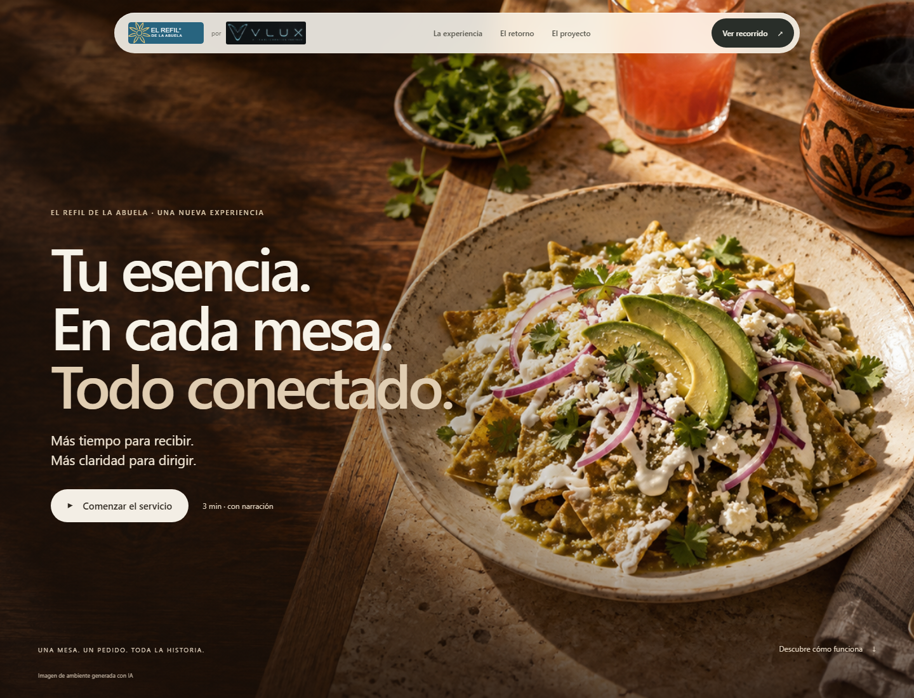
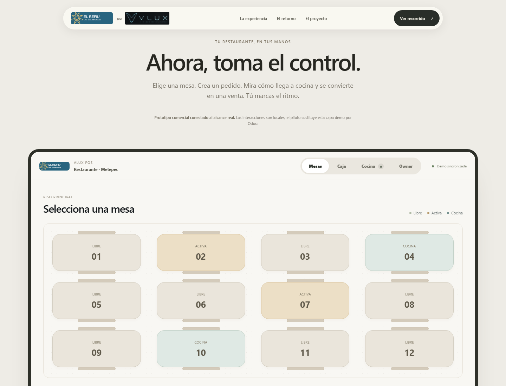
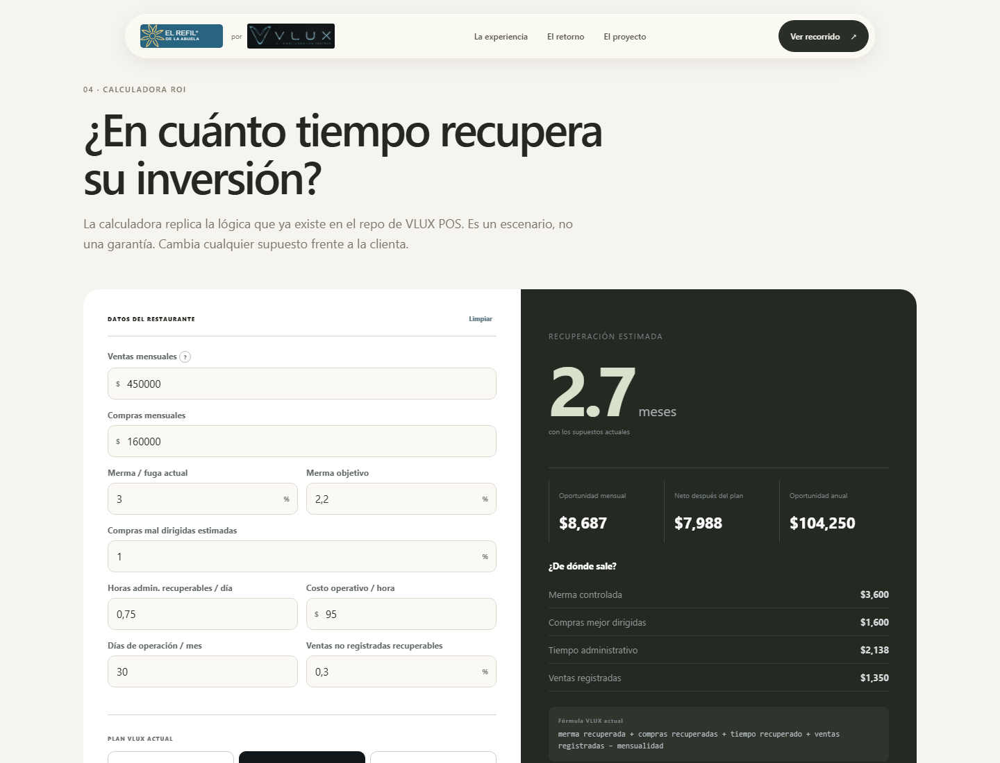
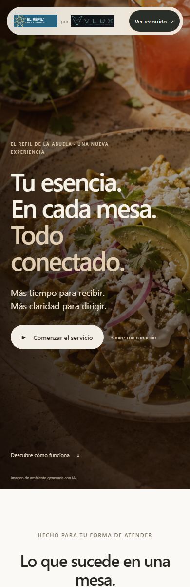

# VLUX x El Refil - Experiencia interactiva

Demo comercial interactiva para presentar como VLUX puede llevar la operacion de **El Refil de la Abuela** a una experiencia mas clara, premium y vendible: mesas, comandas, cocina, cobro, vista de dueno, ROI y recorrido guiado con voz.

Demo publicada: [https://vlux-el-refil-demo.vercel.app](https://vlux-el-refil-demo.vercel.app)



## Que incluye

- Experiencia web estatica lista para abrir en navegador o publicar en Vercel.
- Recorrido guiado por 10 escenas con narracion y subtitulos.
- Selector de voz entre Camila y Enrique desde el reproductor de la demo.
- Flujo operativo de restaurante: mesas, caja, cocina, pedido listo, cobro y dashboard Owner.
- Calculadora ROI editable para conversar con el cliente usando supuestos visibles.
- Identidad visual con logo oficial de VLUX y marca de El Refil.
- Assets locales: imagen editorial, logos, audios MP3 y capturas para documentacion.

## Capturas

### Flujo POS



### Calculadora ROI



### Vista movil



## Como abrir localmente

No requiere instalacion para ver la demo.

1. Abrir `index.html` en Chrome o Edge.
2. Tambien se puede ejecutar `ABRIR_DEMO.bat` en Windows.
3. Para compartir con cliente, usar la demo publicada en Vercel.

## Estructura principal

```text
.
|-- index.html
|-- app.js
|-- experience.js
|-- experience-scenes.js
|-- experience.css
|-- refil-design.css
|-- styles.css
|-- assets/
|   |-- narration/
|   |-- screenshots/
|   |-- vlux-official.png
|   |-- vlux-logo.png
|   |-- refil-logo.svg
|   `-- breakfast-editorial.png
|-- vercel.json
`-- README.md
```

## Experiencia guiada

El recorrido narra una venta completa en restaurante: bienvenida, salon, pedido, cocina, servicio listo, pago, vista del dueno, valor del proyecto, ROI y cierre. La demo conserva un estado local para simular la operacion sin depender de una integracion real.

Los audios estan en `assets/narration/` y se cargan segun la voz elegida:

- `*-camila.mp3`
- `*-enrique.mp3`

Si un audio no carga, el navegador intenta usar voz sintetica como respaldo.

## Alcance real

Esta demo es una pieza comercial y de validacion. La operacion final debe conectarse a los sistemas reales del restaurante, validar permisos, usuarios, hardware, pagos, menu, mesas y reportes. El ROI mostrado es editable y sirve para conversacion comercial; no es una garantia financiera.

## Despliegue

El proyecto ya esta preparado para Vercel con `vercel.json`.

```bash
vercel deploy --prod
```

La configuracion publica actual usa encabezado `X-Robots-Tag: noindex, nofollow` para evitar indexacion de buscadores mientras se usa como demo comercial.

## Notas de origen

- El logo oficial de VLUX se incorporo desde el material de marca proporcionado por el usuario.
- La imagen editorial de desayuno fue generada como ambiente visual para la demo; no representa una fotografia real del restaurante.
- El repositorio GD-V2.0 se consulto solo como referencia de experiencia guiada y animacion; no se modifico.
